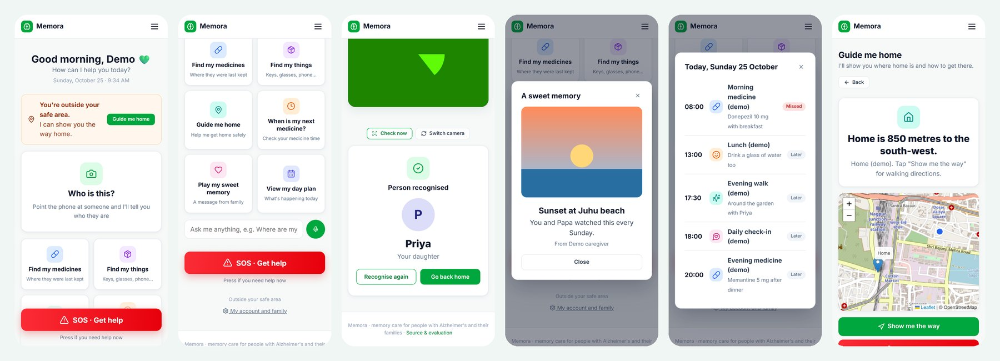
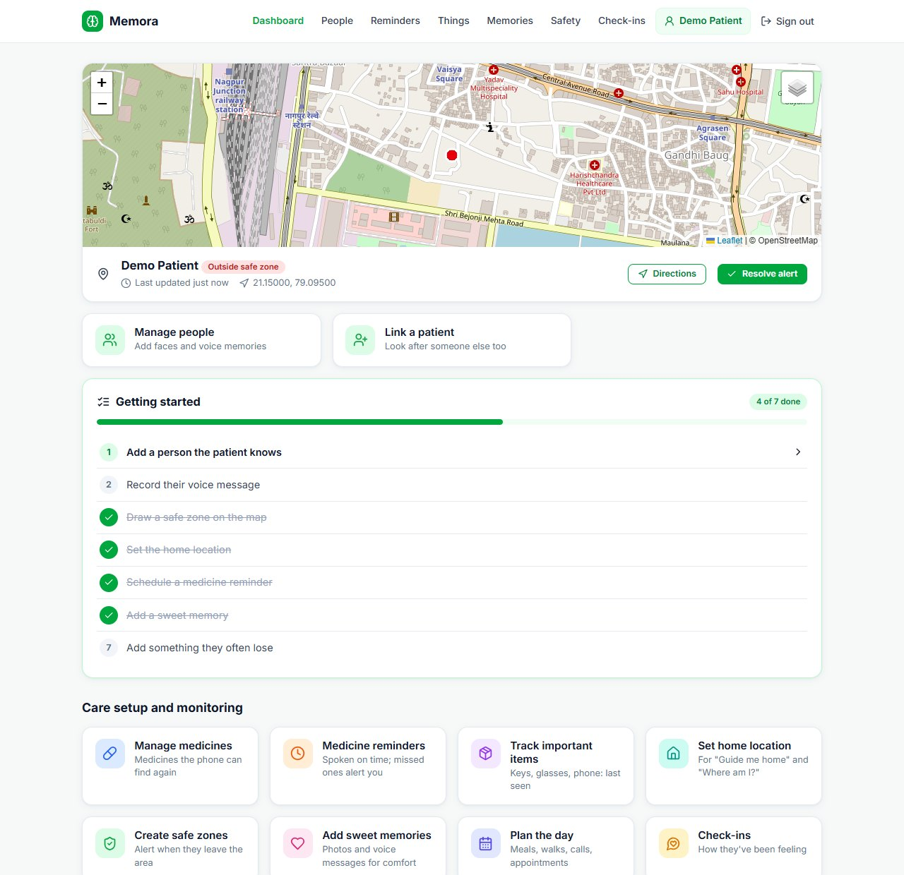
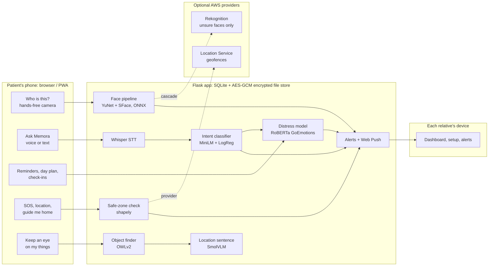

# 🧠 Memora: memory care that a person with Alzheimer's never has to learn

[](https://rajthebuilder-memora.hf.space)
[](https://github.com/rajveer1421/Memora/actions/workflows/tests.yml)
[](https://github.com/rajveer1421/Memora/actions/workflows/deploy.yml)


**▶ Try it: [rajthebuilder-memora.hf.space](https://rajthebuilder-memora.hf.space)**
 · Space page: [huggingface.co/spaces/RajTheBuilder/memora](https://huggingface.co/spaces/RajTheBuilder/memora)
 · [Evaluation results](results/RESULTS.md)
 · [Design case study](https://drive.google.com/file/d/1fEkdFQ_bi4Hg4xjqnhm73N2pbmSp06ut/view)
 · [Figma](https://www.figma.com/make/HSvitCD0Qhm9bt6kEOsltI/ARKA-Dashboard)

A friend's grandfather, who has Alzheimer's, walked out of the house and was lost for a whole day. Memora is
built for that family. On the **patient's phone**, it tells them who is in front of them, then plays a message
in that person's own voice. It finds their keys and medicines, walks them home and reminds them what's next.
On **each relative's phone**, it shows where the patient is, what happened today and when something is wrong.
The patient never has to learn an app: recognition is hands-free, and the right help appears by itself when
they leave the safe zone or sound distressed.


<sub>The patient app (demo data, no real faces): home with the outside-the-safe-zone prompt, the six helpers and SOS,
"Who is this?" result (name and relationship, never a percentage), a sweet memory, the day plan, guide me home.</sub>

---

## Highlights

| | Before (original project) | Memora now | How it was measured |
|---|---|---|---|
| Face recognition accuracy | 87.1% | **98.9%** (95% CI 98.2–99.5) | LFW View 1: thresholds fitted on DevTrain, scored on DevTest (disjoint identities) |
| Face pipeline time (detect + embed) | 395 ms | **≈21 ms** (6 ms YuNet + 15 ms SFace) | Median on a laptop CPU, ONNX Runtime |
| Stranger taken for a family member (200 people enrolled) | 17.4% with a fixed threshold | **1.3%** | Open-set test: 1,000 never-enrolled LFW identities, 20 random galleries |
| A photo with no face in it | "recognised" a ceiling at 99% | **rejected, with the reason** | No-face regression tests; 0 detection failures on DevTest |
| Distress detection (F1) | 0.39 (keyword rules) | **0.88**: precision 91%, recall 86% | 140-sentence care-context set; threshold calibrated on GoEmotions validation |
| False distress alarms | 19 | **6** | Same set ("my daughter is so **help**ful" used to raise *fear* at 95%) |
| Voice-assistant intent accuracy | 36% (keyword rules) | **82.6%** | 86 held-out questions written with different phrasing |
| Tests | none | **81 offline tests in CI**, plus a **53/53** end-to-end check on the live deployment | pytest with AWS stubbed; scripted run against the Space |

## Project at a glance

- **What it is:** a full-stack, ML-heavy web app (installable PWA) with two separate products, one for the patient
  and one for the family, sharing one backend. Deployed free on Hugging Face ZeroGPU; optional AWS providers.
- **Built by:** Rajveer Gupta. Product and UX design (Figma case study), ML evaluation and model selection,
  backend, frontend, security and privacy, MLOps and deployment.
- **ML:** face detection, alignment and open-set recognition with calibrated probabilities
  (YuNet + SFace, ONNX). Emotion and distress classification (RoBERTa, GoEmotions). A trained intent classifier
  (MiniLM embeddings + logistic regression, published on the Hugging Face Hub). Speech-to-text (Whisper).
  One-shot object detection (OWLv2) with a grounded vision-language description (SmolVLM).
- **Stack:** Python 3.12, Flask, SQLite, PyTorch, Hugging Face Transformers, ONNX Runtime, OpenCV,
  faster-whisper, scikit-learn, MLflow, boto3 (Amazon Rekognition, Amazon Location Service), shapely,
  Leaflet + OpenStreetMap, vanilla JavaScript PWA with Web Push, AES-GCM encryption (cryptography),
  Gradio Server on Hugging Face ZeroGPU, GitHub Actions, pytest.
- **Engineering:**
  - every model compared against baselines on held-out data, with confidence intervals;
  - thresholds that adapt to the number of people enrolled;
  - a cloud fallback gated by consent, cost caps and automatic fallback;
  - files encrypted at rest, and account deletion that also erases the cloud copies;
  - CSRF and XSS protection with regression tests;
  - CI/CD to a GPU Space with a CPU fallback.
- **Recognition for the earlier prototype** (ARKA, per the design case study): Microsoft Imagine Cup 2025
  International Qualifier (team lead, 60k+ teams); Best Innovation Award, Tech Expo 2026 (Tinkerers' Lab, IIT Hyderabad).

## What it does

**Two users, two products, chosen on the first screen.** The patient and each relative have their own sign-in
page, navigation and screens. Only the data is shared.

| | Feature | How it works |
|---|---|---|
| 🔍 | **"Who is this?"** | Hands-free: the patient's camera checks every 2.5 s, no button needed. Memora **says the name first, then the person's own recorded voice memory starts by itself**. It says so when it isn't sure or doesn't know the person. The match percentage is shown to family, **never to the patient**. |
| 👤 | **Familiar faces** | A relative adds a person with 1–3 photos and records their voice. Photos become face embeddings and are **not stored**. |
| 🔑 | **Find my things / medicines** | Register keys, glasses or a medicine box with 1–3 photos. The **patient's own phone is the camera**: propped up on *Keep an eye on my things*, it sends a frame every few seconds. Memora keeps the **last photo** where each item was seen, with a sentence such as "on the couch, next to a cat". Frames without a registered item are thrown away. "Where is my mouse?" answers with that photo. |
| 🗣️ | **Ask Memora** | Spoken or typed: "Did I take my tablets?", "Where am I?", "Who is Rahul?". Answers come **only from Memora's own records**, never generated text, so it can't make things up. |
| 🏠 | **Guide me home** | Family pins home on a map; the patient sees how far and which way, with one tap to walking directions. Leaving the safe zone brings it up by itself. |
| 💗 | **Sweet memories** | Family photos with a few words and a recorded message. Memora **offers one on its own** when the patient sounds distressed or confused. |
| 🔔 | **Reminders and day plan** | Medicines, meals, activities and appointments, spoken aloud on time. "When is my next medicine?" is one tap. Not done after 30 minutes → the family is alerted. |
| 💬 | **Check-ins and distress flags** | A daily "How are you feeling?" (voice or a 5-face scale) and everything said to Ask Memora are read by the emotion model. Distress, confusion and the same question asked 3 times in 30 minutes are flagged. |
| 🆘 | **SOS and safe zones** | One tap sends the location to **every linked relative**, and the patient is told who was alerted. Leaving a safe zone drawn on the map alerts them too. GPS jitter inside the reported accuracy counts as "uncertain", not an alarm. |
| 📊 | **Family dashboard** | Live location (map or satellite) with *Directions* and *Resolve*, a **guided first setup in a fixed order** (add a person → record their voice → draw a safe zone → …), alerts, recent activity, and model-health monitoring. |
| 👨‍👩‍👧 | **Accounts and linking** | A relative can link a patient **only if the patient's account exists**: their username plus a one-time 6-digit code shown on the patient's phone. Several relatives per patient, several patients per relative. The patient can remove relatives or delete everything. |


<sub>Family dashboard (demo data): live location with directions, guided setup, care-setup cards.</sub>

## Design

The interface follows the **[product design case study](https://drive.google.com/file/d/1fEkdFQ_bi4Hg4xjqnhm73N2pbmSp06ut/view)**
and the **[Figma design](https://www.figma.com/make/HSvitCD0Qhm9bt6kEOsltI/ARKA-Dashboard)** made before the build
(the mock-ups use the project's earlier name, ARKA). Its principles became rules in the code:

- **The patient never has to operate the app.** Recognition runs hands-free. Leaving the safe zone brings up
  *Guide me home*. Distress brings up a sweet memory. Reminders speak for themselves.
- **Familiar beats clever.** Answers come in a relative's own recorded voice, after Memora has said the name.
- **Two users, two products.** Nothing on the patient's screen exists for the family's benefit.
- **Privacy by design.** Faces are kept as embeddings, frames without a registered item are discarded, and
  stored photos and recordings are encrypted.

The case study ended with a "what I would change next" list. All three items are built in: no confidence
number on the patient's screen, a voice memory that never depends on a tap, and an ordered first setup.

## Architecture



- **One Flask backend, two front ends.** Server-rendered Jinja pages with vanilla JavaScript; every page loads
  its data from a JSON API guarded by role checks (`caregiver_required`, `patient_only`, `patient_required`).
- **On Hugging Face**, Flask runs inside `gradio.Server` (FastAPI) through an ASGI dispatcher. Heavy models run
  in `@spaces.GPU` functions on ZeroGPU, and anything that fails or hits the GPU quota falls back to CPU.
- **Background work**: a scheduler thread flags missed reminders. A one-worker pool writes the VLM location
  sentences, so a camera frame never waits for it. At startup, AWS data left behind by a wiped database is
  cleaned up.
- **Everything works with no cloud account.** AWS sits behind the same interfaces as the local code and is
  switched on by configuration.

## The ML, and how it was evaluated

Every number comes from a script in [`eval/`](eval) and is collected in **[results/RESULTS.md](results/RESULTS.md)**
(`bash eval/run_all.sh`). Each model was compared with simpler baselines on held-out data, with 95% confidence
intervals. Latencies are on a laptop CPU (Intel Core Ultra 5 125H).

### Face recognition: fixing the pipeline before changing the model

The original project used DeepFace's ArcFace with a detector cascade that **embedded the whole frame when no
face was found**, so a photo of a ceiling was "recognised" as a family member at 99%. Its README quoted
ArcFace's paper result (99.83%, ResNet-100). The pipeline it actually ran scored **87.1%** on LFW.

| Pipeline (LFW DevTest, thresholds from DevTrain) | Accuracy (95% CI) | TAR / FAR at accept threshold | Embed time | Licence |
|---|---|---|---|---|
| Original (DeepFace ArcFace-R34 + Haar cascade) | 87.1% (85.0–89.2) | 75.8% / 1.6% | 395 ms incl. detection | – |
| Same ArcFace-R34, with YuNet detection + 5-point alignment | 97.1% (96.0–98.1) | 88.8% / 0.0% | 57 ms | MIT |
| **SFace + YuNet (default)** | **98.9% (98.2–99.5)** | **98.0% / 0.2%** | **15 ms** | Apache-2.0 |
| InsightFace MobileFaceNet + YuNet | 99.2% (98.6–99.7) | 99.0% / 0.4% | 7 ms | non-commercial |
| InsightFace ResNet-50 + YuNet | 99.5% (99.0–99.9) | 99.4% / 0.4% | 201 ms | non-commercial |

- **+10 points came from detection and alignment alone**, on the same model. SFace is the best model with a
  permissive licence: its confidence interval overlaps MobileFaceNet's, but both InsightFace models are licensed
  for non-commercial research only, and ResNet-50 is 13× slower. Embedding times are medians on a laptop CPU
  (YuNet detection adds about 6 ms per image).
- **Calibrated confidence.** The probability shown to the family is Platt-scaled on DevTrain (ECE 0.009 on
  DevTest). It replaces the old `100 − distance/0.68 × 40` formula, which could never go below 60%.
- **Open-set identification**, which is how the app is really used: a few family members plus strangers.
  Every enrolled person is another chance for a stranger to be matched by mistake. With a fixed threshold, the
  stranger false-match rate grows from 0.8% at 10 people to 17% at 200. Memora sets the per-comparison
  threshold from *target ÷ gallery size*, which keeps the stranger false-match rate at **0.8%, 1.3% and 1.3%** for
  10, 50 and 200 people (fixed threshold: 0.8%, 5.0%, 17.4%). The cost: correct matches drop from 98.3% to 96.8%
  at 200 people, and those cases become "unsure" or "I don't know" rather than a wrong name. No genuine probe was
  matched to the wrong person under this policy. For a family of 10–30 people the two policies are nearly the
  same; the scaling matters for a care home.
- **Quality: explain, don't block.** The first version refused dark or blurry photos. Measured on degraded
  DevTest probes, SFace still accepts 97% of blurred genuine faces, while blocking them cut acceptance to 13%,
  with 0% false accepts either way. So Memora always tries. A dark photo that doesn't match gets "retake in
  better light" instead of "I don't know this person". Doubtful detections are still refused, and low-quality
  photos are never sent to the cloud.
- **No fine-tuning, on purpose.** A family has a handful of photos per person; fine-tuning on that would
  overfit. Enrolling people into a gallery is the right design.

### Distress and confusion (pretrained model, used directly)

[`SamLowe/roberta-base-go_emotions`](https://huggingface.co/SamLowe/roberta-base-go_emotions) (RoBERTa-base
trained on GoEmotions) is used as it is, pinned to the evaluated revision. Its 28 labels are mapped to 8: the
Ekman six, neutral, and **confusion**, kept separate instead of folded into *surprise* because it matters most
in dementia care. The flag threshold is calibrated on GoEmotions **validation**; no test data is used for any choice.

| Model | Care-context distress F1 (95% CI) | Precision / recall | Missed (of 71) | Confusion handled |
|---|---|---|---|---|
| Keyword engine (original) | 0.393 (0.27–0.50) | 54% / 31% | 49 | 28% |
| TF-IDF + logistic regression | 0.707 (0.61–0.79) | 76% / 66% | 24 | 44% |
| j-hartmann DistilRoBERTa (pretrained) | 0.770 (0.68–0.84) | 81% / 73% | 19 | 22% |
| **SamLowe RoBERTa GoEmotions (pretrained)** | **0.884 (0.82–0.94)** | **91% / 86%** | **10** | **89%** |

The care-context set has 140 sentences **written by the author, not collected from patients**. It covers negation ("I'm not scared"), confusion and Indian English, so it shows the model handles
these patterns; it is not evidence of clinical accuracy.

### Ask Memora intent classifier (trained)

all-MiniLM-L6-v2 sentence embeddings + multinomial logistic regression with an out-of-scope threshold. C and
the threshold were chosen by 5-fold cross-validation, and the run is tracked in MLflow. Weights are stored as
plain arrays (no pickle), and the model is [published on the Hub](https://huggingface.co/RajTheBuilder/memora-intent-minilm).

| Model (86 held-out questions) | Accuracy (95% CI) | Macro-F1 | "Need help" recall |
|---|---|---|---|
| Keyword rules | 36.0% (26.7–46.5) | 0.375 | 33% |
| TF-IDF + logistic regression | 66.3% (55.8–76.7) | 0.669 | 56% |
| **MiniLM + logistic regression** | **82.6% (74.4–90.7)** | **0.840** | **78%** |

**Honest limits:**
- Typed romanised Hindi is understood 1 time in 9. Spoken Hindi works better, because Whisper translates it
  to English first.
- Because "need help" recall is 78%, the **SOS button**, not the assistant, is the primary safety path.

### Object finder

OWLv2 with **image-guided one-shot queries** from the family's photos, so it can tell *your* keys from any
keys, with a text query as fallback. Reference photos are embedded once at registration. Each frame is one pass,
however many objects are registered, and frames where nothing moved are skipped. SmolVLM writes the location
sentence from a red box and two narrow questions put into a fixed template. With a free-form prompt it had copied
the prompt's example word for word ("on the bedside table, next to the lamp" for a remote on a couch).
**Not yet evaluated on real photos:** the [protocol and script](eval/OBJECTS_PROTOCOL.md) are ready but need
~30 photos of real items, so the detection thresholds are provisional.

## Engineering decisions worth a look

- **The cloud is a fallback, not the default.** Amazon Rekognition is consulted only when all of these hold:
  - the local model is unsure;
  - the photo is of good quality;
  - the family ticked cloud consent for that person;
  - the monthly call cap has room left.

  Any error falls back to the local answer. Amazon Location geofencing is called only after real movement,
  under a cap, and its agreement with the local check is monitored.
- **Privacy in the storage layer.**
  - Files are encrypted with AES-256-GCM. The patient id and file name are bound in as associated data, so a
    file moved into another patient's folder won't decrypt.
  - Deleting an account also deletes that patient's Rekognition collection and geofences in AWS.
  - Cloud resources are named per deployment, so a laptop and the Space never share them.
- **Linking that can't be abused.** A relative needs the patient's username **and** a one-time code from the
  patient's own phone. "No such user" and "wrong code" return the same message, so usernames can't be probed.
  Guesses are rate-limited.
- **Hands-free without noise.** Frames from the hands-free camera never call the paid cloud API. They are
  logged only when someone is recognised, at most once per person every 10 minutes, so the monitoring numbers
  stay meaningful.
- **Security, regression-tested.**
  - CSRF tokens on every state-changing request.
  - A test that fails the build if any template inserts user data unescaped. It was added after finding XSS
    in 8 places in the original project.
  - Server-generated file names (the original had a path-traversal bug), private file serving with HTTP Range
    support, and upload limits.
- **GPU on a free tier.** ZeroGPU calls carry the visitor's quota token through a request shim. When the
  quota runs out, the same function runs on CPU.

## MLOps, at the scale this project actually has

- **Reproducible evaluation:** one script per model, JSON results committed, and `results/RESULTS.md` generated from them.
- **Pretrained first:** candidates are compared on the same splits, and a pretrained model is used directly
  when it wins. For distress it did.
- **Experiment tracking:** MLflow with a SQLite backend. **Model registry:** the intent model is on the Hugging Face Hub with a model card.
- **Pinned weights:** SHA-256-checked ONNX files and pinned Hub revisions.
- **CI/CD:** 81 offline tests on every push, with no API keys (AWS stubbed with botocore's `Stubber`), then an
  automatic redeploy to the Space.
- **Monitoring in the product:** the dashboard's *system health* panel tracks:
  - face unsure, retake and rejected rates, and latency;
  - cloud calls against their caps;
  - agreement between the AWS and local geofence checks;
  - the assistant's out-of-scope rate and the distress flag rate.

## Run it yourself

```bash
conda create -n memora312 -c conda-forge python=3.12 pip && conda activate memora312
pip install torch==2.11.0 --index-url https://download.pytorch.org/whl/cpu
pip install -r requirements-dev.txt
cp .env.example .env                     # every key is optional
python training/train_intent.py          # ~1 min
python app.py                            # http://127.0.0.1:8000
```

1. On the patient's phone, choose **I'm the patient** and create an account.
2. Open **My account and family** and tap **Show my code**.
3. On your own device, choose **I'm a caregiver**, create an account, and link the patient with their username
   and that code.
4. Follow the dashboard's *Getting started* list.

To skip the setup, `python scripts/seed_demo.py --email … --password … --patient-password …` creates a linked
demo pair.

- **Tests:** `pytest` (offline, no keys) · **Evaluation:** `bash eval/run_all.sh`
- **Deploy:** Hugging Face Space (free ZeroGPU), Docker or local. See [DEPLOYMENT.md](DEPLOYMENT.md).

## Project structure

```
app.py, app_hf.py        entry points (Flask locally; Hugging Face Space via gradio.Server)
memora/
  config.py              every setting, from environment variables
  auth.py                patient and caregiver accounts, linking codes, roles, CSRF
  db.py, storage.py      SQLite schema; AES-GCM encrypted private file store
  assistant.py           Ask Memora answers built from records + confusion / repeat / distress signals
  geo.py, alerts.py      safe zones (local + AWS), alerts and Web Push
  scheduler.py, gpu.py   missed-reminder sweep; ZeroGPU bridge with CPU fallback
  routes/                faces, objects, memories, reminders, check-ins, assistant, safety, dashboard
  ml/                    face (+ calibration), face_providers (local / Rekognition / cascade),
                         distress, intent, stt, objects (OWLv2), vlm (SmolVLM), models (pinned weights)
templates/, static/      patient and family UIs (Jinja2 + vanilla JS), icons, service worker, PWA manifest
training/, eval/         intent training + Hub publishing; evaluation scripts and test data
results/                 metrics (JSON) + RESULTS.md
tests/                   81 offline tests
docs/                    screenshots
```

## Limitations and what's next

- **A website only uses the camera and location while it is open.** Background tracking needs a native app.
  The next step after that is camera glasses, so *Who is this?* is something the patient simply wears.
- **No SMS yet:** alerts go to the dashboard and Web Push. SMS/WhatsApp is the next channel.
- **Single-node storage:** SQLite and local files suit a household or a small clinic. At scale this would move
  to Postgres, object storage, a KMS for keys, and separate inference workers.
- **Roles:** all linked relatives have the same rights. Care homes would need view-only and approval roles.
- **Data:** the care-context and intent test sets are small and author-written. Clinical claims would need real,
  consented usage data. The object finder isn't evaluated on real photos yet.
- **Free demo:** the Space's disk is wiped on restart, so use it to try Memora, not to rely on it.
- **Not a medical device:** flags are prompts for a relative to check in, not diagnoses.
