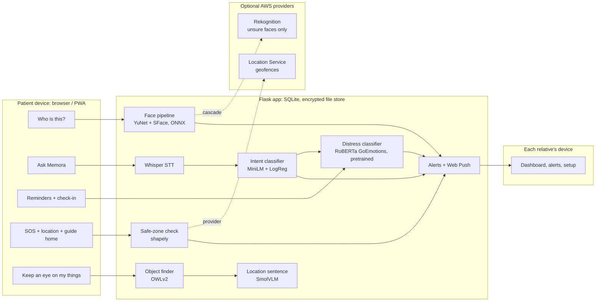

# 🧠 Memora: AI memory-care companion for people with dementia

[](https://github.com/rajveer1421/Memora/actions/workflows/tests.yml)
[](https://github.com/rajveer1421/Memora/actions/workflows/deploy.yml)
<!-- LIVE-DEMO-BADGE -->

> *Every face is a memory worth keeping.*

Memora is a web app (installable as a PWA) for a person living with dementia and the relatives who look
after them. It is **two products that share only the data**:

- **The patient's phone** has one screen with one main action, *Who is this?*. Memora recognises the person
  and says their name, then plays a message in that person's own recorded voice. Around it are six helpers:
  *Find my medicines*, *Find my things*, *Guide me home*, *When is my next medicine?*, *Play my sweet memory*
  and *View my day plan*, plus an SOS button that never scrolls away. The same phone is the camera that notices
  where the keys or the medicine box were last left.
- **Each relative's phone or laptop** has a dashboard: live location with directions, a guided first setup,
  people and voices, medicines and reminders, home and safe zones, sweet memories, alerts and recent activity.
  Several relatives can share one patient, and one relative can look after several patients.

Everything works **without any cloud service**. AWS Rekognition (face fallback) and Amazon Location Service
(safe-zone checks) can be switched on behind the same interfaces as the local models, with per-person
consent, monthly cost caps, and automatic fallback to the local result.

**[Results](results/RESULTS.md)** · **[Deployment](DEPLOYMENT.md)** · **[Object-finder evaluation protocol](eval/OBJECTS_PROTOCOL.md)** · **[Design case study](https://drive.google.com/file/d/1fEkdFQ_bi4Hg4xjqnhm73N2pbmSp06ut/view)** · **[Figma](https://www.figma.com/make/HSvitCD0Qhm9bt6kEOsltI/ARKA-Dashboard)**

---

## Features

| | Feature | How it works |
|---|---|---|
| 👤 | **Familiar faces** | A relative adds a person with 1–3 photos and records a voice memory. Photos are turned into face embeddings and **not stored**. |
| 🔍 | **"Who is this?"** | Hands-free: the patient's camera looks every 2.5 s, no button needed. YuNet detection → 5-point alignment → SFace embedding → calibrated open-set match. Memora **says the name first, then the voice memory starts by itself** (the play button is only a fallback). It says when it isn't sure or doesn't know the person. The match percentage is shown to family, **never to the patient**. |
| 🔑 | **Find my things / medicines** | Register keys, glasses or a medicine box with 1–3 photos. The **patient's own phone** is the camera: propped up with *Keep an eye on my things* open, it sends a frame every few seconds. OWLv2 image-guided detection finds **this** item (text query as fallback). Memora keeps the **last frame** where it was seen plus a short VLM-written location ("on the couch, next to a cat"). Frames without a registered item are discarded. "Where is my mouse?" answers with that photo. |
| 🗣️ | **Ask Memora** | Spoken or typed questions ("Did I take my tablets?", "Where am I?", "Who is Rahul?") → Whisper speech-to-text → trained intent classifier → answer filled **only from Memora's own records** (no free-text generation, so it can't invent facts). The home-screen helpers (*next medicine*, *day plan*) give the same answers without the classifier. |
| 🏠 | **Guide me home** | The family pins home on a map. The patient sees how far home is and in which direction, with one tap to walking directions. If the phone reports the patient outside the safe zone, the home screen offers it unprompted. |
| 💗 | **Sweet memories** | Family photos with a few words and a recorded message. The patient can play them any time, and Memora **offers one by itself** when Ask Memora or a check-in shows distress or confusion. |
| 🔔 | **Reminders and day plan** | Medicines, meals, activities and appointments in the patient's time zone, spoken aloud on time. *View my day plan* shows what's done, missed and next. Not marked done within 30 minutes → alert. |
| 💬 | **Check-ins & distress flags** | A daily "How are you feeling?" (voice and/or a 5-face scale), plus everything said to Ask Memora, is classified by a pretrained RoBERTa emotion model (GoEmotions, used directly; 8 emotions incl. *confusion*). Possible distress, confusion, and the same question repeated within 30 minutes are flagged. |
| 🆘 | **SOS & safe zone** | One-tap SOS with location, sent to **every linked relative**; the patient is told who was alerted, or that nobody is linked yet. Relatives draw safe zones on a map; leaving one raises an alert (GPS jitter within the reported accuracy is "uncertain", not an alarm). |
| 📊 | **Family dashboard** | Live location (map or satellite) with *Directions* and *Resolve*, a **guided first setup in a fixed order** (add a person → record their voice → draw a safe zone → …), care-setup cards, alerts, recent activity, and a model-health panel. Alerts are pushed with free Web Push. |
| 👨‍👩‍👧 | **Accounts** | Separate sign-in pages for patients and caregivers, chosen on the first screen. A relative can link a patient **only if the patient's account exists**, using the patient's username plus a one-time 6-digit code shown on the patient's phone. Several relatives per patient, several patients per relative. The patient can see and remove their relatives, or delete their account. |

### Design

The interface follows the **[product design case study](https://drive.google.com/file/d/1fEkdFQ_bi4Hg4xjqnhm73N2pbmSp06ut/view)** and the **[Figma design](https://www.figma.com/make/HSvitCD0Qhm9bt6kEOsltI/ARKA-Dashboard)** made before the build
(the mock-ups use the project's earlier name, ARKA). Its principles became rules in the code:

- **The patient never has to operate the app.** Recognition runs hands-free. Leaving the safe zone brings up *Guide me home*. Distress or confusion brings up a sweet memory. Reminders speak for themselves.
- **Familiar beats clever.** Answers come in a relative's own recorded voice, after Memora has said the name.
- **Two users, two products.** Separate sign-in pages, navigation and screens for patient and family. Only the data is shared.
- **Privacy by design.** Faces are kept as embeddings, frames without a registered item are thrown away, and stored photos and recordings are encrypted.

The case study's own "what I'd change next" list is built in: no confidence number on the patient's screen, a voice memory that starts by itself, and an ordered first setup for a new relative.

What a website can't do (see [Scalability](#scalability-and-limitations)): it only uses the camera and
location **while the page is open**, and there is no SMS channel yet.

## Architecture



## The ML, and how it was evaluated

All numbers come from scripts in [`eval/`](eval) and are collected in **[results/RESULTS.md](results/RESULTS.md)**
(regenerate with `bash eval/run_all.sh`). Latencies are on a laptop CPU (Intel Core Ultra 5 125H).

### Face recognition: fixing the pipeline before changing the model

The first version of Memora used DeepFace's ArcFace with a detector cascade that **embedded the whole frame
when no face was found**: a photo of a ceiling was "recognised" as a registered person at 99%. Its README
claimed ArcFace's 99.83% (the paper's ResNet-100); the actual pipeline scored **87.1%** on LFW.

Protocol: LFW View 1. Thresholds and Platt calibration are fitted on **DevTrain**; all results are on
**DevTest** (1,000 pairs, disjoint identities).

| Pipeline | LFW accuracy (95% CI) | TAR / FAR at accept threshold | Embed time | Licence |
|---|---|---|---|---|
| Original Memora (DeepFace ArcFace-R34 + Haar cascade) | 87.1% (85.0–89.2) | 75.8% / 1.6% | 218 ms incl. detection | – |
| Same ArcFace-R34, with YuNet detection + 5-point alignment | 97.1% (96.0–98.1) | 88.8% / 0.0% | 106 ms | MIT |
| **SFace + YuNet (default)** | **98.9% (98.2–99.5)** | **98.0% / 0.2%** | **9 ms** | Apache-2.0 |
| InsightFace MobileFaceNet + YuNet | 99.2% (98.6–99.7) | 99.0% / 0.4% | 12 ms | non-commercial |
| InsightFace ResNet-50 + YuNet | 99.5% (99.0–99.9) | 99.4% / 0.4% | 162 ms | non-commercial |

- **+10 points came from detection and alignment alone**, on the same model. SFace was chosen because it is
  within the confidence interval of MobileFaceNet, 18× faster than ResNet-50, and permissively licensed.
- **Calibrated confidence**: the shown probability is Platt-scaled on DevTrain (ECE 0.009 on DevTest),
  replacing the old `100 − distance/0.68 × 40` formula, which could never show less than 60%.
- **Open-set identification** (how the app actually works: a small gallery of family members plus strangers)
  is evaluated separately. A stranger gets one chance per enrolled person to be falsely matched, so a fixed
  threshold's false-match rate grows with the gallery (measured: 0.8% at 10 people → 17% at 200). Memora
  therefore sets the per-comparison threshold from **target / gallery size**; see RESULTS.md for both policies.
- **Quality gate: explain, don't block.** The first version refused dark or blurry photos. Measured on
  degraded DevTest probes (floors tuned on DevTrain with isotonic regression), SFace still accepts 97% of
  blurred genuine faces, while blocking them dropped acceptance to 13%. False accepts were 0% either way.
  So Memora always recognises; a dark/blurry photo that doesn't match gets "retake in better light" instead
  of "I don't know this person". Doubtful detections (tiny face, low detector score) are still refused,
  registration photos must pass the gate, and low-quality photos are never sent to Rekognition.
- **Fixing the model is not the same as fine-tuning it**: Memora deliberately does *not* fine-tune on a
  family's few photos (that would overfit). Enrolment into a gallery is the right design.

### Check-in distress classifier (pretrained, used directly)

[`SamLowe/roberta-base-go_emotions`](https://huggingface.co/SamLowe/roberta-base-go_emotions) (RoBERTa-base
trained on **GoEmotions**, MIT licence) is used as it is, pinned to the evaluated revision. Its 28 labels are
mapped to 8 classes: the Ekman six, neutral, and **confusion** (kept separate instead of folded into
*surprise*, because it matters most in dementia care). Distress = max P(fear, sadness, anger, confusion);
the flag threshold is calibrated on GoEmotions **validation**, and no test data is used for any choice.

| Model | Care-context distress F1 (95% CI) | Missed distress (of 71) | Confusion handled (of 18) | GoEmotions test distress F1 |
|---|---|---|---|---|
| Keyword engine (original Memora) | 0.393 (0.27–0.50) | 49 | 28% | 0.272 |
| TF-IDF + logistic regression | 0.707 (0.61–0.79) | 24 | 44% | 0.591 |
| j-hartmann DistilRoBERTa (pretrained, 7 classes) | 0.770 (0.68–0.84) | 19 | 22% | n/a (in its training data) |
| **SamLowe RoBERTa GoEmotions (pretrained, used directly)** | **0.884 (0.82–0.94)** | **10** | **89%** | **0.660** |

The care-context test set (140 sentences) was **written by the project author, not collected from patients**.
It includes the original keyword engine's failure cases ("My daughter is so **help**ful, the **who**le family
visited" used to raise a *fear* alert at 95%), negation ("I'm not scared"), confusion and Indian English.
The intervals are wide because the set is small; it shows the model handles these patterns, not clinical accuracy.

### Ask Memora intent classifier (trained)

all-MiniLM-L6-v2 embeddings + multinomial logistic regression with an out-of-scope threshold (C and the
threshold chosen by 5-fold CV on the training questions). Weights are stored as plain arrays (`weights.npz`),
not a pickle. Test set: 86 questions written separately with different phrasing, typos and romanised Hindi.

| Model | Accuracy (95% CI) | Macro-F1 | "Need help" recall |
|---|---|---|---|
| Keyword rules | 36.0% (26.7–46.5) | 0.375 | 33% |
| TF-IDF + logistic regression | 66.3% (55.8–76.7) | 0.669 | 56% |
| **MiniLM + logistic regression** | **82.6% (74.4–90.7)** | **0.840** | **78%** |

Honest limits: romanised Hindi is **1/9** (English-only encoder; *spoken* Hindi is translated to English by
Whisper first). The out-of-scope threshold did not improve accuracy (83.7% without it, within the CI) but is
kept so unrelated questions get "I'm not sure" instead of a confident wrong answer. Because "need help"
recall is 78%, the **SOS button**, not the assistant, is the primary safety path.

### Object finder

OWLv2 (open-vocabulary detection) with **image-guided one-shot queries** from the caregiver's photos, so it can
tell *your* keys from any keys, and a text query as fallback. Each reference photo is embedded once at
registration; a frame is one image pass whatever the number of objects. Scene-change gating skips frames
where nothing moved. SmolVLM writes the location sentence, grounded by a red box and two narrow questions
("what is it lying on?", "what is next to it?") filled into a fixed template: in testing, a free-form
prompt with an example was copied verbatim ("on the bedside table, next to the lamp" for a remote on a couch).

**Evaluation status:** the protocol and script are ready ([eval/OBJECTS_PROTOCOL.md](eval/OBJECTS_PROTOCOL.md)):
dev/test split, thresholds tuned on dev, COCO-detector and text-only baselines, a "someone else's keys" test,
and hand-rated hallucination rate for the sentences. It needs ~30 photos of the owner's own items; until it
has run, the detection thresholds are provisional defaults (smoke test on COCO images: the image-guided
score separated a remote from a no-remote room only at a strict threshold, so the default is 0.90).

## Optional AWS providers

| | Default (local) | AWS provider | Safeguards |
|---|---|---|---|
| Face | Own pipeline | `MEMORA_FACE_PROVIDER=cascade`: Rekognition only for good-quality faces in the calibrated *unsure* band | Only people whose caregiver ticked **cloud consent** are indexed; monthly call cap; any error → local result |
| Safe zone | shapely point-in-polygon | `MEMORA_GEOFENCE_PROVIDER=aws`: Amazon Location `ForecastGeofenceEvents` | Calls only after real movement / time; monthly cap; local answer always computed and **agreement monitored** |

Azure Face was not used: identification/verification is a Limited Access feature only for Microsoft-managed
customers. Azure Maps' geofencing APIs were retired in September 2025.

## MLOps, at the scale this project actually has

- **Reproducible evaluation**: one script per model, JSON results committed, `results/RESULTS.md` generated.
- **Use pretrained models when they're good enough**: every candidate is evaluated on the same splits; the
  distress model is a pretrained one used directly because it beat the alternatives on the care-context set.
- **Experiment tracking**: MLflow (SQLite backend) for the intent classifier: params, CV score, git commit.
- **Model registry**: the intent classifier is published to the Hugging Face Hub with a model card (`training/publish_models.py`).
- **Pinned weights**: SHA-256-verified ONNX files (`memora/ml/models.py`) and pinned Hub revisions for pretrained models.
- **CI**: 81 offline tests on every push, with no API keys (AWS stubbed with botocore's `Stubber`), then automatic
  redeploy to the Hugging Face Space.
- **Monitoring**: the dashboard's *model health* panel tracks real usage: face "unsure"/rejected rates and latency,
  Rekognition and Location calls against their caps, AWS/local geofence agreement, assistant out-of-scope rate,
  distress flag rate.

## Privacy and safety

- Face **photos are not stored**; only embeddings. Voice messages, sweet memories, object photos and camera
  frames are **encrypted at rest** (AES-256-GCM; the patient id and file name are bound in, so a file copied to
  another patient's folder will not decrypt) and served only after an access check.
- Camera frames are kept only when a registered item is in them, and only the newest 5 per item.
- Biometric data goes to AWS **only** in cloud mode, **only** for people with recorded consent (India's DPDP Act:
  consent from the person or, for a patient who can't consent, their lawful guardian).
- **Deleting an account deletes everything, including the copies in AWS** (the patient's Rekognition collection
  and geofences). Anything left behind, e.g. by a Space restart that wiped the database, is removed at the next start.
- Speech is transcribed on the server (Whisper). The browser's own recogniser (which, in Chrome, sends audio
  to Google) is only a disclosed fallback.
- Not a medical device: flags are prompts for a caregiver to check in, not diagnoses.
- Security: CSRF protection, escaped output everywhere (regression-tested), server-generated file names,
  upload limits, rate-limited sign-in and linking (10 code guesses per 10 minutes per IP; a code expires after 15 minutes),
  per-patient data isolation, debug mode off.

## Getting started

```bash
conda create -n memora312 -c conda-forge python=3.12 pip && conda activate memora312
pip install torch==2.11.0 --index-url https://download.pytorch.org/whl/cpu
pip install -r requirements-dev.txt
cp .env.example .env                     # everything is optional
python training/train_intent.py          # ~1 min
python app.py                            # http://127.0.0.1:8000
```

On the patient's phone choose **I'm the patient** and create an account; in **My account and family** tap
**Show my code**. On your own device choose **I'm a caregiver**, create an account and link the patient with
their username and that code. Then follow the dashboard's *Getting started* list.
`python scripts/seed_demo.py --email … --password … --patient-password …` creates a linked demo pair with
reminders, a home and a safe zone.

- **Tests:** `pytest` (offline, no keys)
- **Evaluation:** `bash eval/run_all.sh` → `results/RESULTS.md`
- **Deployment:** Hugging Face Space (free ZeroGPU), Docker, or local: see [DEPLOYMENT.md](DEPLOYMENT.md)

## Project structure

```
app.py, app_hf.py        entry points (Flask; Hugging Face Space via gradio.Server)
memora/                  the application
  config.py              every setting, from environment variables
  auth.py, db.py, storage.py, alerts.py, geo.py, assistant.py, scheduler.py
  routes/                faces, reminders, check-ins, objects, memories, assistant, safety, dashboard
  ml/                    face (+ calibration/), face_providers (local / Rekognition / cascade),
                         distress, intent, stt, objects (OWLv2), vlm, models (pinned weights)
templates/, static/      UI (Jinja2 + vanilla JS), Lucide icon sprite, service worker, PWA manifest
scripts/                 seed_demo.py, build_icons.py
training/                train_intent.py, publish_models.py, data/
eval/                    face, intent, distress, object evaluations; report.py; data/
results/                 metrics (JSON) + RESULTS.md
tests/                   81 offline tests
```

## Scalability and limitations

- **A website only reads the camera and location while the page is open.** Background location tracking, and
  watching for things with the screen off, need the native app version. The interaction model is meant to
  move further still: on camera glasses, *Who is this?* becomes something the patient simply wears.
- **No SMS yet.** Alerts reach caregivers through the dashboard and free Web Push. An SMS/WhatsApp channel
  (e.g. Twilio) is the next step for caregivers without a smartphone browser open.
- **Storage**: SQLite and local files suit one household or a small clinic. A larger deployment would move to
  Postgres plus object storage, and run the scheduler and model inference as separate workers.
- **Roles**: every linked relative has the same rights today. Larger families or care homes would want roles
  (e.g. view-only, or a lead caregiver who approves new links).
- **Encryption keys**: the file key is derived from the server secret. Rotating it would need re-encrypting
  files; a production deployment would keep keys in a KMS.
- **Languages**: English models. Spoken Hindi is translated by Whisper; typed romanised Hindi is not understood
  yet (measured: 1/9). A multilingual encoder and Indian-language check-in data are the fix.
- **Evaluation data**: the care-context and intent test sets are small and author-written; real (consented)
  usage data would be needed to claim clinical performance.
- **Free demo**: the Hugging Face Space's disk is wiped on restart, so the public demo is for trying Memora,
  not for real use.
